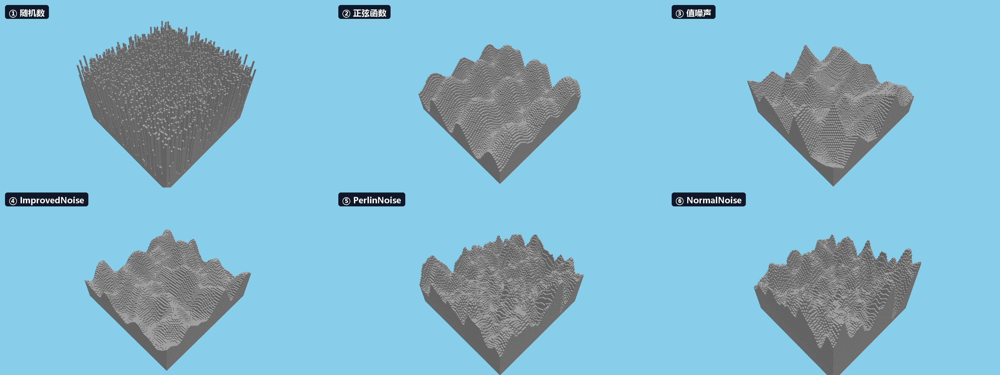

# MC Noise Demo

仓库（网页）：<https://github.com/kamikesola/mc-noise-demo>  
git clone：<https://github.com/kamikesola/mc-noise-demo.git>

《我的世界》地形噪声演示：从随机数、正弦、值噪声，到 `ImprovedNoise`、`PerlinNoise`、`NormalNoise`。

同一个 seed、同一个镜头下，六种高度函数并排对比：



配套文章：待发布（发布后把知乎链接补到这里）。

## 运行

```bash
npm install
npm run dev
```

打开终端里 Vite 输出的地址（默认 `http://localhost:3000`）。

生产构建：

```bash
npm run build
npm run preview
```

## 操作

| 按键 | 作用 |
| --- | --- |
| `1`–`6` | 切换六种高度函数 |
| `R` | 换一个随机种子 |
| `H` | 隐藏 / 显示 HUD |
| `V` | 重置镜头 |
| 鼠标拖拽 | 旋转 |
| 滚轮 | 缩放 |

`&hud=0` 可以直接截无 HUD 的图。

## 六种模式

| 键 | 模式 | 说明 |
| --- | --- | --- |
| `1` | `random` | 每个格子独立哈希，针山 |
| `2` | `smooth` | 正弦，周期但平滑 |
| `3` | `value` | 晶格随机值 + 双线性 |
| `4` | `perlin` | MC 1.21.1 的 `ImprovedNoise`，单层 3D 噪声切片 |
| `5` | `octaves` | `PerlinNoise` 叠 3 个 octave |
| `6` | `normal` | `NormalNoise`，两个 `PerlinNoise` 相加 |

URL 示例：

```text
/?mode=random&seed=42
/?mode=value&seed=42
/?mode=perlin&seed=42
/?mode=octaves&seed=42
/?mode=normal&seed=42
```

## 代码结构

```text
src/
  main.ts               Three.js 场景、HUD、按键、URL 参数
  heights.ts            六种高度函数 + MC 1.21.1 坐标常量
  legacyRandomSource.ts 48 位 LCG（BigInt）
  improvedNoise.ts      ImprovedNoise 的逐行移植
  perlinNoise.ts        PerlinNoise 的 octave 循环
  normalNoise.ts        NormalNoise 的双 Perlin + valueFactor
  assets/stone.png      石头方块贴图
scripts/
  stats.mjs             六版本范围/高差统计
  verify-value-noise.mjs  值噪声连续性验证
  verify-interpolation.mjs 插值端点/范围/边界验证
```

验证脚本：

```bash
node scripts/stats.mjs
node scripts/verify-value-noise.mjs
node scripts/verify-interpolation.mjs
```

## 坐标与范围

- 主世界 Y：`-64..320`，海平面 `63`；
- 地表实际约 `29..93`；
- 渲染时从当前地形最低点往下 4 格开始填，避免画整根基座；
- 世界大小 `96×96`。

## 文章配图用的隐藏参数

这些参数不在 UI 里，只用于生成文章里的参数研究图：

| 参数 | 作用 |
| --- | --- |
| `firstOctave` | 覆盖 `PerlinNoise` 的最低频 octave |
| `amplitudes` | 逗号分隔，例如 `1,0.7,0.5` |
| `octaveOnly` | 只画某个 octave 的贡献，`0` / `1` / `2` |
| `componentScale` | 单 octave 图的放大倍数 |
| `layers` | `normal` 模式下 `1` = 单个 PerlinNoise，`2` = NormalNoise |

示例：

```text
/?mode=octaves&amplitudes=1,0.7,0.5&seed=42&hud=0
/?mode=octaves&firstOctave=-6&seed=42&hud=0
/?mode=octaves&octaveOnly=1&componentScale=140&seed=42&hud=0
/?mode=normal&layers=1&seed=42&hud=0
```

## 说明

- `ImprovedNoise` 是 3D 梯度噪声，不是完整的 `PerlinNoise` 类；`PerlinNoise` 在 `perlinNoise.ts` 里叠 octave。
- `NormalNoise` 的结构、`valueFactor`、`1.0181268882175227` 偏移与 MC 1.21.1 源码一致；demo 用 `LegacyRandomSource` + 旧 `PerlinNoise` 构造，不保证与 `PositionalRandomFactory` 逐位相同。
- 所有随机都是确定性的，没有用 `Math.random()` 生成地形；只有 URL 里没给 `seed` 时才会随机挑一个种子。

## License

MIT
